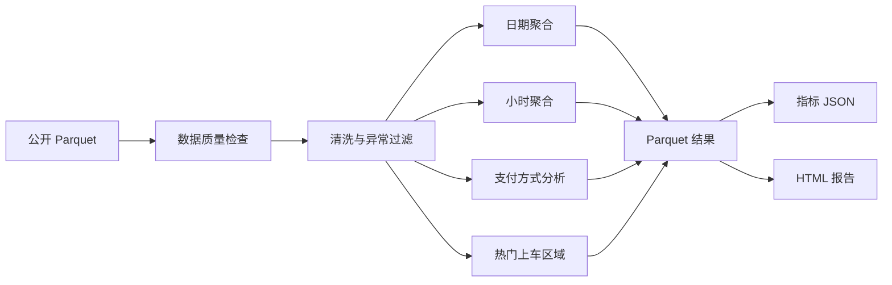

# NYC Yellow Taxi Batch Data Pipeline

基于纽约市出租车与豪华轿车委员会公开数据的大数据处理项目。使用 DuckDB 直接读取
Parquet 文件，完成数据质量检查、清洗、日期与小时聚合、支付方式分析和热门上车区域分析。

## 真实运行结果

数据处理月份：2025 年 1 月

| 指标 | 结果 |
| --- | ---: |
| 原始记录 | 3,475,226 |
| 清洗后有效记录 | 3,322,947 |
| 剔除异常记录 | 152,279 |
| 数据保留率 | 95.62% |
| 总营收 | 88,306,933.90 美元 |
| 平均客单价 | 17.72 美元 |
| 平均行程距离 | 3.16 英里 |
| 平均行程时长 | 14.68 分钟 |
| 行程最多日期 | 2025-01-25，133,041 单 |
| 行程最多小时 | 18:00，242,156 单 |

## 数据来源

纽约市官方出租车数据：

`https://www.nyc.gov/site/tlc/about/tlc-trip-record-data.page`

项目默认分析：

`https://d37ci6vzurychx.cloudfront.net/trip-data/yellow_tripdata_2025-01.parquet`

仓库包含从该公开数据集中抽取的 1,000 行样本，用于离线测试和持续集成。
完整 56 MB Parquet 文件不提交到仓库，可通过脚本重新下载。

## 数据处理流程



## 数据质量规则

清洗过程会标记并过滤：

- 缺失或非法时间。
- 上车时间不在目标月份。
- 下车时间早于或等于上车时间。
- 行程时长超过 180 分钟。
- 距离小于等于 0 或超过 100 英里。
- 总金额为负数。
- 乘客人数不在 0 到 6 之间。

实际异常统计：

| 规则 | 数量 |
| --- | ---: |
| 非正行程时长 | 2,051 |
| 超长行程 | 1,377 |
| 非法距离 | 91,055 |
| 非法总金额 | 63,037 |
| 乘客人数异常 | 18 |
| 目标月份外记录 | 22 |

## 技术设计

- DuckDB 直接查询 Parquet，避免将完整数据全部加载到 Python 内存。
- SQL 完成数据清洗、质量统计和维度聚合。
- 输出每日、小时、支付方式和上车区域四张 Parquet 结果表。
- metrics JSON 记录完整运行指标和数据质量结果。
- 自动生成 HTML 分析报告。
- Pytest 使用真实数据样本验证清洗与聚合逻辑。

## 运行

下载完整月份数据：

```powershell
.\download_data.ps1
```

运行完整流水线：

```powershell
.\run_pipeline.ps1
```

使用仓库中的样本数据运行：

```powershell
python -m pipeline.run
```

运行测试：

```powershell
.\run_tests.ps1
```

## 输出结构

```text
reports/
├── metrics.json
├── report.html
└── tables/
    ├── daily_summary.parquet
    ├── hourly_demand.parquet
    ├── payment_summary.parquet
    └── pickup_zones.parquet
```

## 目录结构

```text
nyc-taxi-data-pipeline/
├── pipeline/
│   ├── download.py            # 下载官方 Parquet
│   └── run.py                 # 清洗、聚合和报告生成
├── data/
│   └── sample_yellow_tripdata_2025-01.csv
├── tests/
│   └── test_pipeline.py
├── docs/
│   ├── index.html
│   └── test-report.html
├── requirements.txt
├── download_data.ps1
├── run_pipeline.ps1
└── run_tests.ps1
```

## 简历写法

```text
基于纽约市官方 347 万条出租车公开数据完成大数据批处理项目，使用 DuckDB 和 SQL
实现 Parquet 直读、数据质量检查、异常清洗、日期与小时聚合及支付方式分析。
通过多项质量规则保留 95.62% 的有效记录，生成每日指标、热门上车区域等 Parquet
结果表和 HTML 报告；使用 Pytest 对清洗、聚合和结果一致性进行自动化验证。
```

## 项目边界

这是基于公开数据的个人数据分析项目，不代表企业生产集群。当前使用单机 DuckDB
完成中等规模批处理；进一步扩展可使用 Spark 或云数据仓库处理更高数据量。
